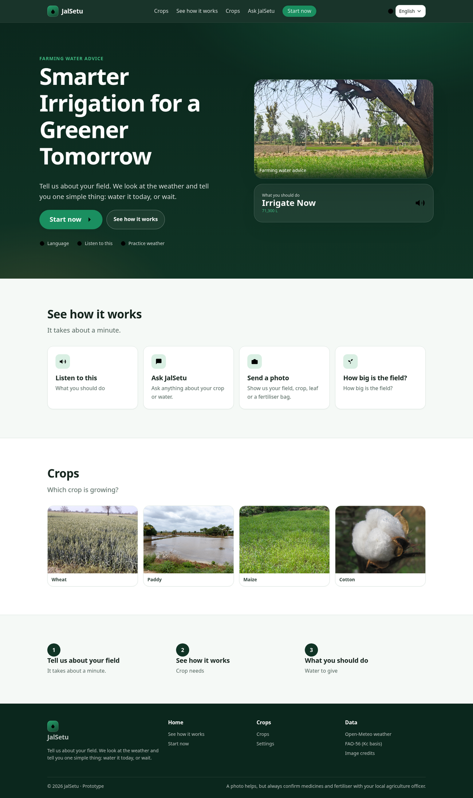
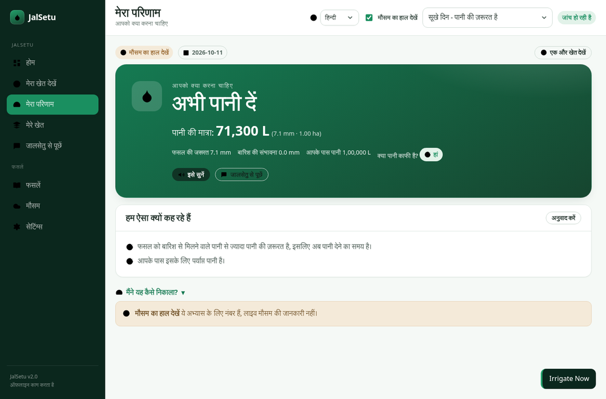
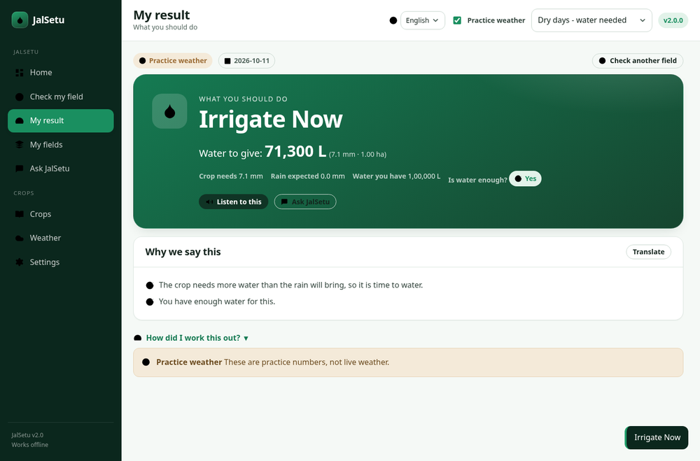
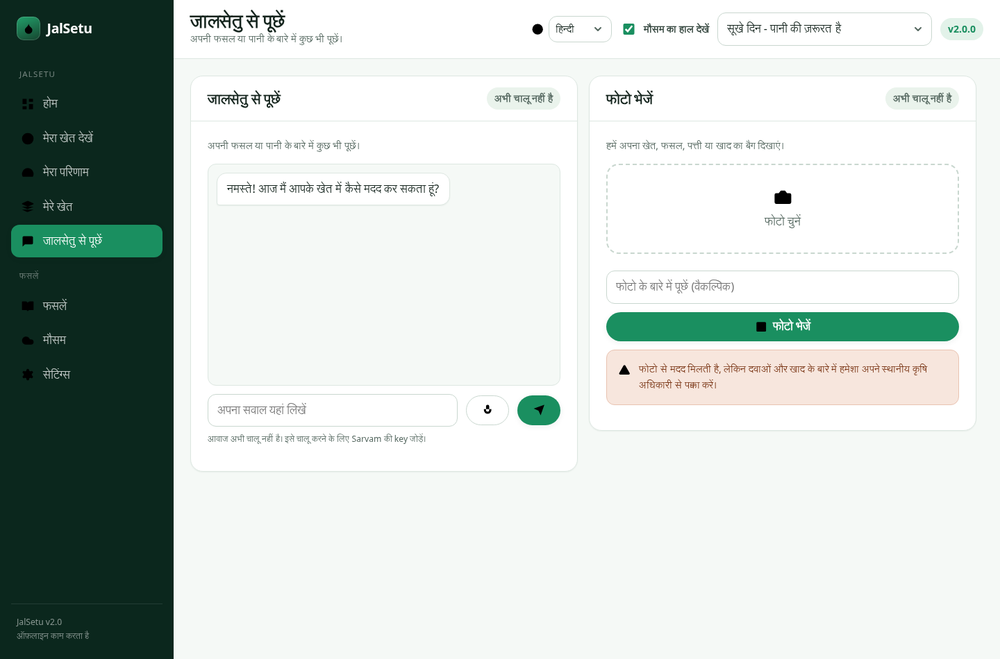

# JalSetu

**An irrigation decision-support app built for Indian farmers — not for engineers.**

JalSetu looks at the local weather and the crop's water need, and tells the
farmer one simple thing: **water it today**, **wait**, or **check the field** —
with the amount in litres, **read aloud in their own language**.

Plain HTML/CSS/JavaScript front end, Python FastAPI back end, Open-Meteo for
weather, and Sarvam AI for language, speech and the assistant. No hardware, no
account, no database. Works offline.

---

## Screenshots

| Landing | Result (Hindi) |
|---|---|
|  |  |

| Result (English) | Ask JalSetu + photo |
|---|---|
|  |  |

The result is one large plain-language sentence; the full calculation sits
behind the *"How did I work this out?"* toggle below it.

---

## 1. What changed in v2 — "user first"

v1 was accurate but aimed at a technical reader. v2 is aimed at the farmer:

- **One big answer.** The result screen is now a single large plain sentence
  ("अभी पानी दें" / "Irrigate Now"), not a wall of tables. The full maths is
  still there, but behind a **"How did I work this out?"** toggle — so a judge
  or agronomist still gets the audit trail.
- **Six languages.** English, हिन्दी, தமிழ், తెలుగు, বাংলা, मराठी — the whole
  interface, including the reasons, with **no English leaking into a
  non-English UI** (verified programmatically).
- **Hear it, and speak it.** Press *Listen* and the advice is spoken (Sarvam
  TTS). Press the mic and ask by voice (Sarvam STT).
- **Ask JalSetu.** A chat assistant for follow-up questions, in the farmer's
  language, aware of the current field analysis.
- **Send a photo.** Show a crop, leaf or fertiliser bag and get a plain
  explanation — with hard safety limits (see §7).
- **Farmer units.** Enter the field in **bigha, acre, hectare or guntha** — not
  just hectares.
- **Real photographs.** Openly-licensed photos of Indian fields and crops
  (see §8).
- **Animations and states**, and a clear "not switched on yet" state wherever
  Sarvam is not configured.

Everything from v1 still holds: the deterministic engine, the three
recommendation states, the transparent breakdown, and the labelled demo mode.

---

## 2. Quick start (Windows PowerShell)

```powershell
# 1. Go to the project folder
cd path\to\jalsetu

# 2. Create and activate a virtual environment
python -m venv .venv
.\.venv\Scripts\Activate.ps1
# If PowerShell blocks activation, allow it for this session only:
#   Set-ExecutionPolicy -Scope Process -ExecutionPolicy Bypass
# ...then run the Activate.ps1 line again.

# 3. Install dependencies
python -m pip install --upgrade pip
pip install -r requirements.txt

# 4. Run the server
python -m uvicorn backend.main:app --reload --port 8000
```

Open **http://127.0.0.1:8000**. The landing page is `/`, the app is `/app`.

> Run uvicorn **from the project root** (`jalsetu/`), not from inside
> `backend/`, so the `backend` package imports resolve.

### macOS / Linux

```bash
cd path/to/jalsetu
python3 -m venv .venv
source .venv/bin/activate
pip install -r requirements.txt
python -m uvicorn backend.main:app --reload --port 8000
```

**JalSetu runs without any key.** Translation, speech, the assistant and photo
help simply show a clear "not switched on yet" notice until you add one.

---

## 3. Getting your Sarvam API key (step by step)

You do **not** need a key to demo the app. Add one when you want the voice,
assistant and photo features.

1. Go to **https://dashboard.sarvam.ai** and create an account (free tier
   available; no credit card needed to start).
2. Sign in, open the **API Keys** section, and **create a new key**. Copy it —
   the dashboard shows it once.
3. In the **project root**, copy the example file and paste your key:

   ```powershell
   Copy-Item .env.example .env
   notepad .env
   ```
   ```bash
   cp .env.example .env
   nano .env
   ```

   Set the single line:

   ```
   SARVAM_API_KEY=your_key_here
   ```

4. **Restart the server.** Open `/app` → **Settings** → the *Sarvam AI* card
   should now read **Ready**.
5. Try **Ask JalSetu** and **Send a photo**. If a photo request reports that
   the model needs beta access, your key is not whitelisted for the multimodal
   endpoint yet — request access from Sarvam, or leave the photo feature off.
   The app tells you plainly rather than failing silently.

### If the key doesn't seem to work

The `.env` reader is deliberately forgiving: it tolerates a UTF-8 BOM (which
Notepad adds), Windows CRLF line endings, quoted values, spaces around `=`, and
a leading `export `. If in doubt, write the file from PowerShell instead:

```powershell
Set-Content -Path .env -Value 'SARVAM_API_KEY=sk_your_key_here' -Encoding ascii
```

Then restart the server and open `http://127.0.0.1:8000/api/sarvam/status` —
it must show `"configured": true`.

**Security rules, and the app enforces them:**

- The key lives only in `.env`, which is listed in `.gitignore`. Never commit it.
- The backend reads it server-side. **It is never sent to the browser** and never
  appears in any front-end file or bundle.
- Never paste the key into chat, a screenshot, or a code file. If you do by
  accident, rotate it in the dashboard immediately.

### Other ways to set the key (instead of `.env`)

```powershell
# PowerShell, current session only
$env:SARVAM_API_KEY="your_key_here"
```
```bash
# macOS / Linux
export SARVAM_API_KEY="your_key_here"
```

---

## 4. Demo in three minutes

1. Open **http://127.0.0.1:8000/app**.
2. Pick a **language** (top bar) — the whole app switches.
3. On **Check my field**, click an example. Each fills the form and answers:

   | Example | Field | Weather | Answer |
   |---|---|---|---|
   | **Dry days** | Wheat, flowering, 1 ha, drip | ET0 6.2 mm, 0 mm rain | **Irrigate Now** |
   | **Rain coming** | Maize, vegetative, 0.8 ha, sprinkler | ET0 4.6 mm, 18 mm rain | **Wait and Reassess** |
   | **Very little water** | Cotton, flowering, 2 ha, flood | ET0 6.8 mm, 0 mm rain, 30,000 L | **Check the Field First** (insufficient water) |

4. The result is one big sentence. Press **Listen** (if Sarvam is set up) or open
   **How did I work this out?** for the arithmetic.
5. **My fields** → *Add examples* to see saved fields analysed. **Ask JalSetu**
   for the assistant and photo. **Crops** for the Kc reference.

### Running the demo with no internet

Everything a presenter needs works offline: tick **Practice weather**, or click
any example. Practice figures are fixed sample data and are always labelled —
they are never presented as live readings. Voice, assistant and photo simply
show "not switched on yet".

---

## 5. The calculation (and its assumptions)

The engine in `backend/irrigation.py` is a pure, deterministic function: the
same inputs always give the same result. It is a **simplified daily water
balance**, and it says so everywhere it is used.

```
1. Crop water demand      ETc = ET0 × Kc                [mm/day]
2. Effective rainfall     Pe  = min(P, ETc)             [mm]
3. Net requirement        NIR = max(0, ETc − Pe)        [mm]
4. Gross applied water    GIR = NIR ÷ efficiency        [mm]
5. Volume                 litres = depth_mm × area_ha × 10,000
```

- **ET0** — reference evapotranspiration from the weather forecast.
- **Kc** — crop coefficient for the crop and growth stage.
- **Efficiency** — drip 90%, sprinkler 75%, furrow 60%, flood 50%.
- **1 mm over 1 hectare = 10,000 litres** — the only volume conversion used.

### Deliberate safeguards

- **Rainfall is applied once.** `Pe = min(P, ETc)` caps rainfall at the day's
  demand; the excess is assumed lost to runoff/percolation. Rainfall is never
  subtracted twice.
- **Forecasts are not soil moisture.** The model is demand-side only.
- **No invented precision.** Simplifications (one day, no soil-water storage, no
  paddy ponding) are stated in the UI and here.
- **No savings claims.** Verified water savings would need a measured baseline.

### Recommendation states

| State | When |
|---|---|
| **Irrigate Now** | Net requirement ≥ 0.5 mm and available water covers the gross need |
| **Wait and Reassess** | Net requirement < 0.5 mm |
| **Inspect Field / More Data Needed** | Missing/invalid inputs, or available water below the gross requirement |

Terminology is kept distinct: **crop water demand** (ETc) is what the crop
needs; **net irrigation requirement** is demand not met by rainfall; **gross
applied water** adds losses.

### Area units

Bigha varies by state. JalSetu converts using a common North-India
approximation (1 bigha ≈ 0.2529 ha), acre = 0.404686 ha, guntha = 0.010117 ha.
The chosen unit is converted to hectares before the engine runs, and the
hectare figure is shown in the breakdown.

---

## 6. API reference

Base URL `http://127.0.0.1:8000`. All JSON.

| Method | Path | Purpose |
|---|---|---|
| GET | `/api/health` | Liveness, version |
| GET | `/api/crops` | Crop reference data (Kc by stage) |
| GET | `/api/meta` | Methods, soils, stages, efficiencies |
| GET | `/api/scenarios` | The three demo scenarios |
| GET | `/api/weather` | Forecast for a location or coordinates |
| POST | `/api/recommendation` | Full recommendation for a field |
| GET | `/api/sarvam/status` | Whether Sarvam is configured (never reveals the key) |
| POST | `/api/translate` | Text translation |
| POST | `/api/tts` | Text to speech (base64 audio) |
| POST | `/api/stt` | Speech to text (audio upload) |
| POST | `/api/chat` | Assistant reply |
| POST | `/api/vision` | Photo question (image upload) |

**`POST /api/recommendation`** body:

```json
{
  "field": {
    "field_name": "Main Field", "crop_id": "wheat", "growth_stage": "flowering",
    "soil_type": "loamy", "area_ha": 1.0, "irrigation_method": "drip",
    "available_water_l": 100000
  },
  "location": "Prayagraj, Uttar Pradesh", "demo": false, "scenario": null,
  "weather_override": null
}
```

Weather resolves in order: `weather_override` → `demo`/`scenario` → live lookup.
Inputs are validated with Pydantic; bad input returns 422.

**Sarvam endpoints** return **503 with `{"code": "not_configured"}`** when no key
is set, so the front end can degrade cleanly. Auth failures map to 403, quota to
402, rate limits to 429.

---

## 7. Safety — what the photo and assistant features will not do

- **No chemical doses.** The assistant is instructed never to give a pesticide
  or fertiliser quantity, and **never from a photo**. For any pest, disease or
  chemical question it directs the farmer to their local Krishi Vigyan Kendra
  (KVK) or agriculture officer.
- **No invented facts.** It is told to say when it is unsure rather than guess.
- **No guaranteed savings.** It does not promise exact water savings.
- The photo feature is scoped to *describe what is visible* and *read labels* —
  not to make a confident identification of a seed variety or a disease.
- A visible disclaimer sits next to the photo tool and in the footer.

The system prompt that enforces this is in `backend/sarvam.py`
(`build_system_prompt`) and is covered by a test.

---

## 8. Images and attribution

Photographs are openly licensed, from Wikimedia Commons. Full credits — title,
licence and author for each file — are in **`ATTRIBUTION.md`** (also served at
`/ATTRIBUTION.md`). CC0 / public-domain images carry no conditions; CC BY-SA
images remain under that licence and must keep their attribution if reused.

---

## 9. Privacy and security

- No authentication, no database. The MVP stores nothing server-side.
- Saved fields and the last result live only in the browser (`localStorage`).
- The only data sent to the server is the field parameters you submit, plus any
  photo or audio you explicitly send to a Sarvam feature.
- **The Sarvam key never leaves the server.** All Sarvam calls are proxied by
  the backend; the browser talks only to `/api/*`.
- Before any production use handling personal data, DPDP Act obligations
  (notice, consent, retention, residency) would need to be designed in — out of
  scope for this prototype.

---

## 10. Testing

```powershell
python -m pytest -q            # 40 tests: engine, API, Sarvam degradation
python scripts\smoke.py        # 23 checks against the real HTTP surface
node scripts\shots_v2.js       # renders every view in headless Chromium
```

The test suite deliberately runs **without** a Sarvam key to prove every Sarvam
endpoint degrades cleanly. Engine tests cover zero rainfall, rainfall exceeding
demand, zero/invalid area, missing weather variables, insufficient water, unit
conversions, determinism and internal consistency.

Verified in this build: 40/40 tests, 23/23 smoke checks, and **zero console or
page errors** across all seven views in all six languages.

---

## 11. Project structure

```
jalsetu/
├── backend/
│   ├── __init__.py      loads .env (no python-dotenv needed)
│   ├── main.py          FastAPI routes, validation, static hosting
│   ├── irrigation.py    deterministic engine (pure functions)
│   ├── weather.py       Open-Meteo client, normaliser, demo scenarios
│   ├── crop_data.py     crop coefficients with stated sources
│   └── sarvam.py        Sarvam proxy: translate, TTS, STT, chat, vision
├── frontend/
│   ├── index.html       landing page
│   ├── app.html         dashboard shell (all views)
│   ├── style.css        design system + components + animations
│   ├── app.js           application logic
│   ├── i18n.js          UI translations (6 languages)
│   ├── i18n-extra.js    reasons, scenario names, labels
│   ├── ATTRIBUTION.md   image credits (served)
│   └── assets/          openly-licensed photos
├── tests/               test_irrigation.py, test_api.py, test_sarvam.py
├── scripts/             smoke.py, fetch_images.py, shots_v2.js
├── .env.example
├── .gitignore
├── requirements.txt
└── README.md
```

---

## 12. Limitations (stated plainly)

- The model is a **single-day** water balance — no soil-water storage across
  days, so it cannot say "wait two days".
- No paddy ponding, groundwater contribution, capillary rise or crop stress
  functions.
- Kc values are **indicative FAO-56 references**, not field-calibrated. The
  "vegetative" coefficient is a documented JalSetu interpolation.
- Soil type is recorded and advised on, but does **not** change the numeric
  balance in this version.
- Bigha conversion is a regional approximation.
- Voice, assistant and photo depend on the Sarvam API and a network connection;
  they are enhancements over a working offline base, not requirements.
- Multimodal photo understanding is **not reliable enough to identify a seed
  variety or diagnose a disease**, and the app is deliberately scoped not to try.
- No verified water savings are claimed.

---

## 13. Built in 24 hours — scope choices

Priority was a **working, explainable, user-first vertical slice**. Charts are
hand-built SVG/CSS (no Chart.js CDN, so nothing breaks offline). React was
avoided entirely. The three demo scenarios are deterministic and
network-independent so a live API cannot derail the presentation, and every
Sarvam feature degrades to a clear notice rather than an error.
